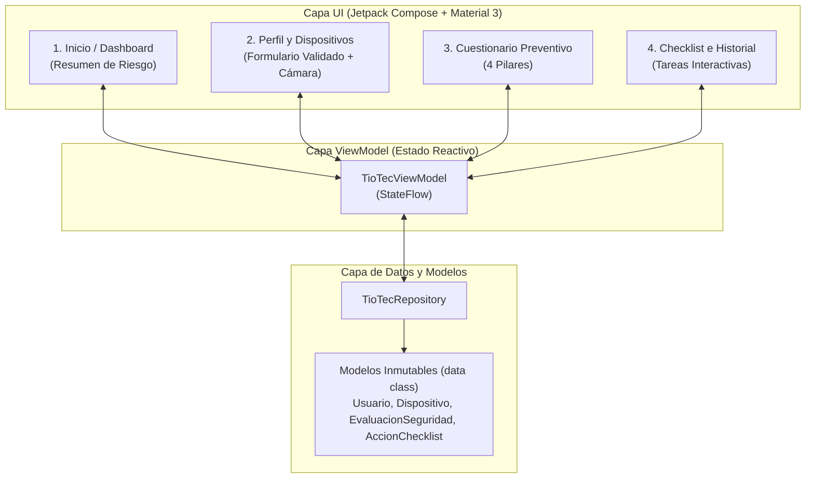

# 02 · Especificación de Requerimientos y Reglas de Negocio

> 📋 Este documento cubre la **Parte 1 de la Guía 7** (Definición de alcance, requerimientos, reglas de negocio y flujo arquitectónico del proyecto semestral).

---

## 1. Requerimientos Funcionales (RF)

| ID | Módulo | Descripción | Archivos de Código Asociados |
| :--- | :--- | :--- | :--- |
| **RF-01** | **Perfil Ficticio** | Permitir crear y actualizar un perfil de prueba (nombre/alias y nivel de experiencia digital: *Principiante, Intermedio, Avanzado*). | `model/Usuario.kt` `viewmodel/TioTecViewModel.kt` |
| **RF-02** | **Inventario de Dispositivos** | Registrar dispositivos ficticios (*Smartphone, Tablet, Notebook, PC*), su sistema operativo y asociar una foto opcional tomada con la **Cámara**. | `model/Dispositivo.kt` `viewmodel/TioTecViewModel.kt` |
| **RF-03** | **Cuestionario Preventivo** | Responder preguntas cerradas sobre los 4 pilares de seguridad: 1. *Respaldos (Backups)* 2. *Actualizaciones de software* 3. *Autenticación reforzada (2FA)* 4. *Recuperación de cuentas* | `model/EvaluacionSeguridad.kt` `repository/TioTecRepository.kt` |
| **RF-04** | **Diagnóstico y Semáforo** | Calcular automáticamente el puntaje total y clasificar el estado en **Riesgo Bajo, Medio o Alto**, mostrando recomendaciones claras. | `model/NivelRiesgo.kt` `viewmodel/TioTecViewModel.kt` |
| **RF-05** | **Checklist de Acciones** | Generar tareas preventivas priorizadas (*Urgente, Recomendado, Opcional*) según las brechas detectadas, permitiendo alternar su estado (*Pendiente / Completada*). | `model/AccionChecklist.kt` `viewmodel/TioTecViewModel.kt` |
| **RF-06** | **Historial de Evaluaciones** | Mantener el registro histórico de las evaluaciones realizadas con su fecha, puntaje y nivel de riesgo. | `model/EvaluacionSeguridad.kt` |

---

## 2. Reglas de Negocio (RN)

1. **RN-01 · Cálculo del Nivel de Riesgo:**
   * **Riesgo Bajo (Verde):** Cumplimiento $\ge 80\%$ del puntaje máximo.
   * **Riesgo Medio (Amarillo):** Cumplimiento entre $50\%$ y $79\%$.
   * **Riesgo Alto (Rojo):** Cumplimiento $< 50\%$.
2. **RN-02 · Generación Automática de Acciones en el Checklist:**
   * Si en una pregunta del cuestionario el usuario obtiene puntaje $0$ (brecha crítica) o $1$ (cumplimiento parcial), el sistema agrega automáticamente la acción preventiva recomendada al Checklist con prioridad `ALTA` (si obtuvo $0$) o `MEDIA` (si obtuvo $1$).
3. **RN-03 · Validaciones de Formulario en Tiempo Real:**
   * El nombre del perfil y el nombre del dispositivo deben tener **mínimo 3 caracteres**.
   * El sistema operativo del dispositivo no puede estar vacío.
   * No se permite finalizar el cuestionario preventivo si faltan preguntas por responder.
4. **RN-04 · Protección y Privacidad:**
   * El sistema trabaja exclusivamente con perfiles y dispositivos simulados; no solicita ni almacena contraseñas reales ni datos personales sensibles.

---

## 3. Diagrama de Flujo y Capas MVVM

