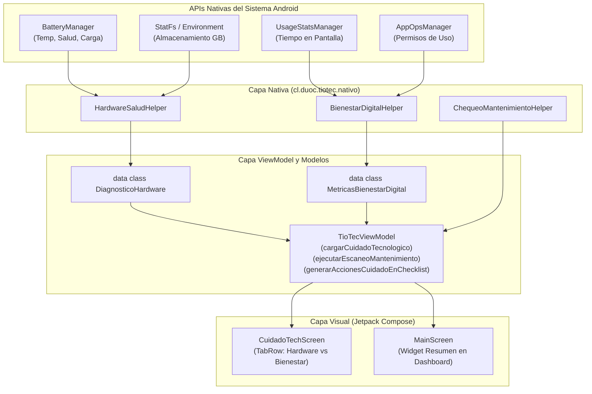

# 05 · Implementación Unidad 3: Cuidado Tecnológico con APIs Nativas de Android

> 📱 **Contexto Académico (DSY1105 - Duoc UC):**  
> Para la empresa **MCmovil SpA** (soporte técnico, reparación y optimización TI), el "Cuidado Tecnológico" trasciende los servicios web externos y se apoya directamente en las **APIs Nativas del SDK de Android** para diagnosticar el estado del hardware en tiempo real y fomentar el bienestar digital del usuario.

---

## 1. Justificación y Selección de APIs Nativas del SDK de Android

| Área de Cuidado | API Nativa del SDK de Android | Propósito Técnico en AppTioTec | Nivel de Permiso Requerido |
| :--- | :--- | :--- | :--- |
| **1. Cuidado del Hardware (Batería y Energía)** | [`BatteryManager`](https://developer.android.com/reference/android/os/BatteryManager) | Monitoreo en vivo de: nivel de carga (%), estado (cargando / batería), tipo de conexión (AC / USB), temperatura térmica (°C), voltaje (mV) y salud de la batería. | Estándar (lectura mediante `Intent.ACTION_BATTERY_CHANGED`). |
| **2. Optimización de Memoria (Almacenamiento)** | [`StatFs`](https://developer.android.com/reference/android/os/StatFs) y [`Environment`](https://developer.android.com/reference/android/os/Environment) | Cálculo del espacio total del almacenamiento interno en GB, memoria libre disponible y porcentaje de uso del sistema. | Estándar (lectura de directorio de datos del sistema). |
| **3. Bienestar Digital (Tiempo en Pantalla)** | [`UsageStatsManager`](https://developer.android.com/reference/android/app/usage/UsageStatsManager) | Consulta de estadísticas de uso en las últimas 24 horas (`INTERVAL_DAILY`), cálculo del tiempo total en pantalla y ranking de aplicaciones más utilizadas. | Especial: `android.permission.PACKAGE_USAGE_STATS`. |
| **4. Seguridad y Gestión de Permisos Especiales** | [`AppOpsManager`](https://developer.android.com/reference/android/app/AppOpsManager) | Verificación reactiva del estado del permiso de acceso a datos de uso (`MODE_ALLOWED`), guiando al usuario hacia `Settings.ACTION_USAGE_ACCESS_SETTINGS` si no está activo. | Ninguno (gestor interno del sistema operativo). |
| **5. Alertas Preventivas Proactivas** | [`NotificationManagerCompat`](https://developer.android.com/reference/androidx/core/app/NotificationManagerCompat) | Emisión de notificaciones prioritarias al detectar anomalías críticas (batería > 40°C, almacenamiento > 88% o tiempo de uso > 5 horas diarias). | `android.permission.POST_NOTIFICATIONS` (Android 13+). |

---

## 2. Nuevas Reglas de Negocio Implementadas

* **RN-05 · Diagnóstico de Salud de Hardware:**
  * **Riesgo Alto (Rojo):** Temperatura de batería $\ge 43^\circ\text{C}$ o almacenamiento ocupado $\ge 92\%$, o batería en estado *Sobrecalentada*.
  * **Riesgo Medio (Amarillo):** Temperatura entre $38^\circ\text{C}$ y $42^\circ\text{C}$, o almacenamiento entre $80\%$ y $91\%$, o batería $\le 15\%$ sin cargador.
  * **Riesgo Bajo (Verde):** Condiciones térmicas y de memoria dentro de los rangos recomendados por el fabricante.

* **RN-06 · Diagnóstico de Bienestar Digital (Higiene de Pantalla):**
  * **Riesgo Alto (Rojo):** Tiempo en pantalla $\ge 300\text{ min}$ (5 horas al día).
  * **Riesgo Medio (Amarillo):** Tiempo en pantalla entre $180\text{ min}$ y $299\text{ min}$ (3 a 5 horas).
  * **Riesgo Bajo (Verde):** Tiempo en pantalla $< 180\text{ min}$ (menos de 3 horas diarias).

* **RN-07 · Generación Automática de Tareas en el Checklist:**
  * Al pulsar *"Agregar Tareas de Cuidado al Checklist"*, el sistema evalúa las métricas en tiempo real y añade tareas priorizadas (*Cuidado térmico*, *Limpieza de almacenamiento* o *Higiene digital*) directamente a la base de datos local SQLite (Room).

---

## 3. Arquitectura MVVM y Flujo Unidireccional (UDF)

---

## 4. Preguntas y Respuestas Clave para la Defensa Oral (Unidad 3)

### ❓ 1. ¿Por qué se utilizaron APIs nativas en lugar de servicios web externos para el cuidado del dispositivo?
* **Respuesta:** Porque para evaluar la salud real de un smartphone (temperatura de la celda de batería, ciclos de carga, memoria interna libre y tiempo de pantalla) **no existe servicio web en la nube que tenga acceso a los sensores físicos del dispositivo**. Las APIs nativas del SDK de Android (`BatteryManager`, `StatFs`, `UsageStatsManager`) operan a nivel de kernel y sistema operativo, garantizando diagnósticos exactos en tiempo real y sin consumir datos móviles del usuario.

### ❓ 2. ¿Cómo protege Android la privacidad del usuario al consultar `UsageStatsManager`?
* **Respuesta:** El acceso a los datos de uso de aplicaciones es un permiso sensible (`PACKAGE_USAGE_STATS`). Android no permite concederlo mediante el diálogo estándar de permisos en tiempo de ejecución. Por ello, utilizamos `AppOpsManager` para verificar si está permitido (`MODE_ALLOWED`). Si no lo está, la aplicación abre de forma segura la pantalla nativa de Ajustes del Sistema (`Settings.ACTION_USAGE_ACCESS_SETTINGS`) para que el usuario sea quien decida otorgar el consentimiento explícito.

### ❓ 3. ¿Cómo se calculó la temperatura de la batería con `BatteryManager`?
* **Respuesta:** En `HardwareSaludHelper.kt` registramos un receptor pasivo para el `Intent.ACTION_BATTERY_CHANGED`. El extra `BatteryManager.EXTRA_TEMPERATURE` devuelve la temperatura en décimas de grado Celsius (por ejemplo, `325` representa $32.5^\circ\text{C}$). Dividimos el valor entre `10.0f` para obtener el valor decimal exacto que se muestra con formato interactivo y alertas visuales si sobrepasa los $40^\circ\text{C}$.

### ❓ 4. ¿Cómo se integran estos diagnósticos con el resto de la aplicación (Checklist y Room)?
* **Respuesta:** Al detectar cualquier riesgo en hardware (memoria llena o sobrecalentamiento) o en hábitos de pantalla, la función `generarAccionesCuidadoEnChecklist()` del `TioTecViewModel` genera instancias inmutables de `AccionChecklist` con prioridad `ALTA` o `MEDIA`, actualizando el `StateFlow` reactivo y persistiendo las tareas en SQLite mediante `TioTecRepository` y `TioTecDao`.
