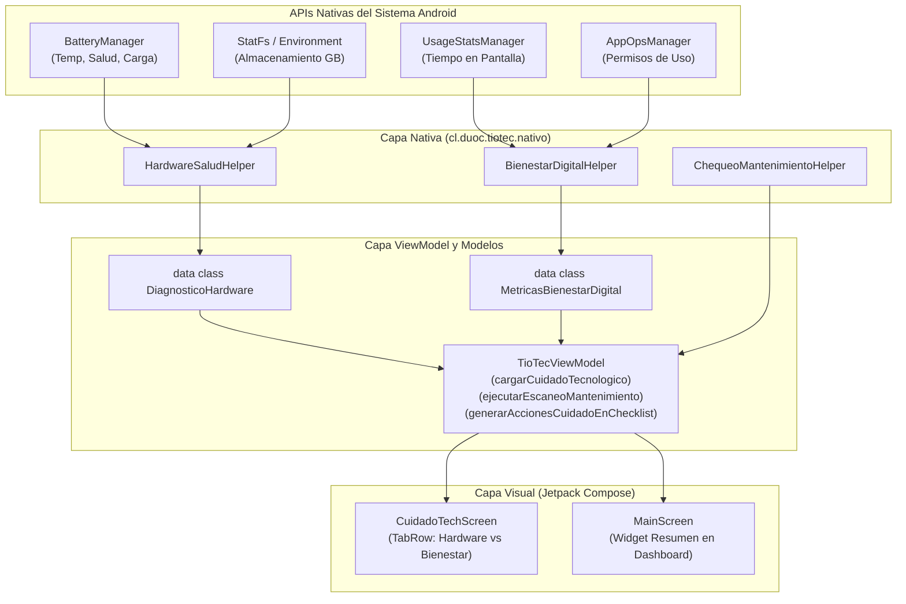

# 05 · Implementación Unidad 3: Cuidado Tecnológico con APIs Nativas de Android

> 📱 **Contexto Académico (DSY1105 - Duoc UC):**  
> Para la empresa **MCmovil SpA** (soporte técnico, reparación y optimización TI), el "Cuidado Tecnológico" trasciende los servicios web externos y se apoya directamente en las **APIs Nativas del SDK de Android** para diagnosticar el estado del hardware en tiempo real y fomentar el bienestar digital del usuario.

---

## 1. Justificación y Selección de APIs Nativas del SDK de Android

| Área de Cuidado | API Nativa del SDK de Android | Propósito Técnico en AppTioTec | Nivel de Permiso Requerido |
| :--- | :--- | :--- | :--- |
| **1. Cuidado del Hardware (Batería y Energía)** | [`BatteryManager`](https://developer.android.com/reference/android/os/BatteryManager) | Monitoreo en vivo de: nivel de carga (%), estado (cargando / batería), tipo de conexión (AC / USB), temperatura térmica (°C), voltaje (mV) y salud de la batería. | Estándar (lectura mediante `Intent.ACTION_BATTERY_CHANGED`). |
| **2. Optimización de Memoria (Almacenamiento)** | [`StatFs`](https://developer.android.com/reference/android/os/StatFs) y [`Environment`](https://developer.android.com/reference/android/os/Environment) | Cálculo del espacio total del almacenamiento interno en GB, memoria libre disponible y porcentaje de uso del sistema. | Estándar (lectura de directorio de datos del sistema). |
| **3. Bienestar Digital (Tiempo en Pantalla)** | [`UsageStatsManager`](https://developer.android.com/reference/android/app/usage/UsageStatsManager) | Consulta de estadísticas de uso en las últimas 24 horas (`INTERVAL_DAILY`), cálculo del tiempo total en pantalla y ranking de aplicaciones más utilizadas. | Especial: `android.permission.PACKAGE_USAGE_STATS`. |
| **4. Seguridad y Gestión de Permisos Especiales** | [`AppOpsManager`](https://developer.android.com/reference/android/app/AppOpsManager) | Verificación reactiva del estado del permiso de acceso a datos de uso (`MODE_ALLOWED`), guiando al usuario hacia `Settings.ACTION_USAGE_ACCESS_SETTINGS` si no está activo. | Ninguno (gestor interno del sistema operativo). |
| **5. Alertas Preventivas Proactivas** | [`NotificationManagerCompat`](https://developer.android.com/reference/androidx/core/app/NotificationManagerCompat) | Emisión de notificaciones prioritarias al detectar anomalías críticas (batería > 40°C, almacenamiento > 88% o tiempo de uso > 5 horas diarias). | `android.permission.POST_NOTIFICATIONS` (Android 13+). |

---

## 2. Nuevas Reglas de Negocio Implementadas

* **RN-05 · Diagnóstico de Salud de Hardware:**
  * **Riesgo Alto (Rojo):** Temperatura de batería $\ge 43^\circ\text{C}$ o almacenamiento ocupado $\ge 92\%$, o batería en estado *Sobrecalentada*.
  * **Riesgo Medio (Amarillo):** Temperatura entre $38^\circ\text{C}$ y $42^\circ\text{C}$, o almacenamiento entre $80\%$ y $91\%$, o batería $\le 15\%$ sin cargador.
  * **Riesgo Bajo (Verde):** Condiciones térmicas y de memoria dentro de los rangos recomendados por el fabricante.

* **RN-06 · Diagnóstico de Bienestar Digital (Higiene de Pantalla):**
  * **Riesgo Alto (Rojo):** Tiempo en pantalla $\ge 300\text{ min}$ (5 horas al día).
  * **Riesgo Medio (Amarillo):** Tiempo en pantalla entre $180\text{ min}$ y $299\text{ min}$ (3 a 5 horas).
  * **Riesgo Bajo (Verde):** Tiempo en pantalla $< 180\text{ min}$ (menos de 3 horas diarias).

* **RN-07 · Generación Automática de Tareas en el Checklist:**
  * Al pulsar *"Agregar Tareas de Cuidado al Checklist"*, el sistema evalúa las métricas en tiempo real y añade tareas priorizadas (*Cuidado térmico*, *Limpieza de almacenamiento* o *Higiene digital*) directamente a la base de datos local SQLite (Room).

---

## 3. Arquitectura MVVM y Flujo Unidireccional (UDF)

---

## 4. Preguntas y Respuestas Clave para la Defensa Oral (Unidad 3)

### ❓ 1. ¿Por qué se utilizaron APIs nativas en lugar de servicios web externos para el cuidado del dispositivo?
* **Respuesta:** Porque para evaluar la salud real de un smartphone (temperatura de la celda de batería, ciclos de carga, memoria interna libre y tiempo de pantalla) **no existe servicio web en la nube que tenga acceso a los sensores físicos del dispositivo**. Las APIs nativas del SDK de Android (`BatteryManager`, `StatFs`, `UsageStatsManager`) operan a nivel de kernel y sistema operativo, garantizando diagnósticos exactos en tiempo real y sin consumir datos móviles del usuario.

### ❓ 2. ¿Cómo protege Android la privacidad del usuario al consultar `UsageStatsManager`?
* **Respuesta:** El acceso a los datos de uso de aplicaciones es un permiso sensible (`PACKAGE_USAGE_STATS`). Android no permite concederlo mediante el diálogo estándar de permisos en tiempo de ejecución. Por ello, utilizamos `AppOpsManager` para verificar si está permitido (`MODE_ALLOWED`). Si no lo está, la aplicación abre de forma segura la pantalla nativa de Ajustes del Sistema (`Settings.ACTION_USAGE_ACCESS_SETTINGS`) para que el usuario sea quien decida otorgar el consentimiento explícito.

### ❓ 3. ¿Cómo se calculó la temperatura de la batería con `BatteryManager`?
* **Respuesta:** En `HardwareSaludHelper.kt` registramos un receptor pasivo para el `Intent.ACTION_BATTERY_CHANGED`. El extra `BatteryManager.EXTRA_TEMPERATURE` devuelve la temperatura en décimas de grado Celsius (por ejemplo, `325` representa $32.5^\circ\text{C}$). Dividimos el valor entre `10.0f` para obtener el valor decimal exacto que se muestra con formato interactivo y alertas visuales si sobrepasa los $40^\circ\text{C}$.

### ❓ 4. ¿Cómo se integran estos diagnósticos con el resto de la aplicación (Checklist y Room)?
* **Respuesta:** Al detectar cualquier riesgo en hardware (memoria llena o sobrecalentamiento) o en hábitos de pantalla, la función `generarAccionesCuidadoEnChecklist()` del `TioTecViewModel` genera instancias inmutables de `AccionChecklist` con prioridad `ALTA` o `MEDIA`, actualizando el `StateFlow` reactivo y persistiendo las tareas en SQLite mediante `TioTecRepository` y `TioTecDao`.

---

## 5. Monitor de Telemetría y Recursos del Sistema

El módulo de **Monitor de Telemetría y Recursos del Sistema** (`TelemetriaSistemaHelper` + modelos en `cl.duoc.tiotec.model.TelemetriaSistema`) amplía el diagnóstico nativo de **AppTioTec** utilizando exclusivamente APIs públicas del SDK de Android (`minSdk = 24`, compatible hasta `compileSdk = 36` mediante comprobaciones `Build.VERSION.SDK_INT`), sin permisos de superusuario (`root`) ni reflexión sobre APIs ocultas.

### 5.1 Muestreo en Vivo (1.5 s) y Pestañas de Visualización

En `CuidadoTechScreen`, el monitor ejecuta un ciclo de muestreo reactivo en tiempo real cada **1.5 segundos** (`LaunchedEffect(state.monitoreoEnVivoActivo)` + `delay(1500L)`), invocando `TioTecViewModel.refrescarTelemetriaEnVivo(context)` sin emitir notificaciones ni `Snackbar` en cada tick. El usuario puede pausar o reanudar la captura desde el control **"Monitor en vivo (1.5s)"** (`TioTecViewModel.alternarMonitoreoEnVivo()`).

El `TioTecUiState` mantiene **6 series temporales deslizantes** (ventana máxima de 24 muestras) para renderizar gráficas `Canvas` tipo **"Rendimiento"** con grilla, línea continua y área rellena:

* `historialRamPorcentaje` (% de RAM ocupada)
* `historialAlmacenamientoPorcentaje` (% de almacenamiento interno ocupado)
* `historialRedBajadaKbps` y `historialRedSubidaKbps` (tráfico global en KB/s)
* `historialCpuAppPorcentaje` (% de CPU del propio proceso)
* `historialPotenciaWatts` (flujo de potencia del dispositivo en Watts)

La interfaz organiza estas lecturas en un `ScrollableTabRow` de 5 pestañas: **Energía y Térmico**, **Rendimiento**, **Hardware y Sensores**, **Mi App (Self-Profiling)** y **Bienestar**.

### 5.2 Los 4 Bloques de Telemetría

1. **Estado global del hardware y red (`EstadoGlobalHardware`):**
   * **Memoria RAM y Almacenamiento:** Reporta RAM total, usada y disponible en MB (`porcentajeRamUsado`, `memoriaBajaSistema`, `umbralMemoriaBajaMb`, `ramAlerta` cuando `memoriaBajaSistema` es `true` o `porcentajeRamUsado >= 85`), además de almacenamiento interno (`almacenamientoTotalGb`, `almacenamientoLibreGb`, `porcentajeAlmacenamientoUsado`).
   * **Cómputo y SoC:** Expone núcleos de CPU disponibles (`nucleosCpu`), arquitectura ABI principal (`arquitecturaCpu`), modelo de SoC (`modeloSoC` vía `Build.SOC_MANUFACTURER` + `Build.SOC_MODEL` en Android 12+ / API 31+ o fallback `Build.HARDWARE` / `Build.BOARD`), modelo del dispositivo, versión de Android y estado de ahorro de energía (`modoAhorroEnergia`).
   * **Estrés térmico y *Thermal Throttling*:** Registra `estadoTermicoCodigo`, `estadoTermicoEtiqueta` (`Normal`, `Leve`, `Moderado`, `Severo`, `Crítico`), `margenTermico` (*headroom*) y activa `alertaThrottling` cuando `estadoTermicoCodigo >= 2` o `margenTermico >= 0.90f`.
   * **Tráfico de red global:** Calcula velocidades en vivo de bajada (`redBajadaKbps`) y subida (`redSubidaKbps`), acumulados totales (`redTotalRxMb`, `redTotalTxMb`) y propiedades formateadas `redBajadaFormateada` / `redSubidaFormateada` (en `KB/s` o `MB/s` si $\ge 1024\text{ KB/s}$).

2. **Flujo energético del dispositivo (`FlujoEnergeticoDispositivo`):**
   * Mide corriente instantánea y promedio en **microamperios (`µA`)** y **miliamperios (`mA`)**: `corrienteInstantaneaUa`, `corrientePromedioUa`, `corrienteInstantaneaMa` y `corrientePromedioMa`, además de capacidad remanente (`capacidadRemanenteMah`), voltaje (`voltajeMv`), temperatura (`temperaturaCelsius`) y fuente de alimentación (`fuenteEnergia`).
   * Calcula en tiempo real la potencia eléctrica en Watts mediante la relación $P\text{ (W)} = \frac{V_{\text{mV}} \cdot |I_{\text{mA}}|}{1\,000\,000}$ redondeada a 2 decimales (`potenciaWatts`).
   * Determina `direccionFlujo` (`"Entrada (Carga)"` vs `"Salida (Descarga)"`) y activa `descargaAltaAlerta` cuando descarga con $\ge 800\text{ mA}$.

3. **Inventario completo de hardware y sensores (`InventarioHardware`):**
   * **Pantallas (`PantallaHardwareInfo`):** Lista pantallas físicas, resolución actual, tasa de refresco activa en Hz y tasas soportadas (`tasasSoportadasHz`).
   * **Cámaras físicas (`CamaraHardwareInfo`):** Lista ID de cámara, ubicación (*Trasera / Frontal / Externa*), nivel de soporte hardware (*Legacy / Limited / Full / Level 3 / External*) y disponibilidad de flash, sin requerir permiso `CAMERA`.
   * **Sensores integrados (`SensorHardwareInfo`):** Enumera los sensores reales del dispositivo con nombre, fabricante, tipo, rango máximo, resolución y consumo eléctrico teórico individual en mA (`consumoMa`), exponiendo el total agregado en `consumoTotalSensoresMa`.

4. **Perfilador propio / *Self-Profiling* (`ConsumoPropiaApp`):**
   * Inspecciona el proceso propio de AppTioTec: `pidProceso`, `uidAplicacion`, tiempo de CPU acumulado (`tiempoCpuMs`), porcentaje de CPU en vivo (`porcentajeCpuApp`), hilos activos (`hilosActivos`), huella física `memoriaPssTotalMb` y memoria JVM (`heapUsadoMb`, `heapAsignadoMb`, `heapMaximoMb`, `porcentajeHeapUsado`).
   * Calcula tráfico de red atribuido al UID propio (`redRxKbps`, `redTxKbps`, `redTotalAppKb`), potencia estimada asignada al proceso (`potenciaEstimadaMw`) y energía acumulada en la sesión (`consumoBateriaSesionMah`).

### 5.3 APIs Públicas del SDK de Android Utilizadas

| Bloque | API Pública del SDK | Métricas Obtenidas | Permisos Requeridos |
| :--- | :--- | :--- | :--- |
| **RAM y sistema** | [`ActivityManager.MemoryInfo`](https://developer.android.com/reference/android/app/ActivityManager.MemoryInfo) (`getMemoryInfo`) | `totalMem`, `availMem`, `lowMemory` y `threshold` convertidos a MB. | Ninguno (API estándar). |
| **Almacenamiento** | [`StatFs`](https://developer.android.com/reference/android/os/StatFs) + `Environment.getDataDirectory()` | Capacidad total, libre y porcentaje ocupado de almacenamiento interno en GB. | Ninguno (API estándar). |
| **SoC** | [`Build`](https://developer.android.com/reference/android/os/Build) (`SOC_MANUFACTURER`, `SOC_MODEL` en API 31+) | Identificación del fabricante y modelo del System-on-Chip (con fallback a `Build.HARDWARE` y `Build.BOARD`). | Ninguno (API estándar). |
| **Térmico y energía** | [`PowerManager`](https://developer.android.com/reference/android/os/PowerManager) (`isPowerSaveMode`, `getCurrentThermalStatus()`, `getThermalHeadroom()`) | Modo ahorro de batería, nivel térmico (API 29+) y margen térmico predictivo (API 30+), con fallback por temperatura de batería en API < 29. | Ninguno (API estándar). |
| **Flujo energético** | [`BatteryManager.BATTERY_PROPERTY_*`](https://developer.android.com/reference/android/os/BatteryManager) (`CURRENT_NOW`, `CURRENT_AVERAGE`, `CHARGE_COUNTER`) | Corriente instantánea/promedio en `µA` y `mA`, más carga remanente en mAh (complementado con `Intent.ACTION_BATTERY_CHANGED`). | Ninguno (API estándar). |
| **Tráfico de red** | [`TrafficStats`](https://developer.android.com/reference/android/net/TrafficStats) (`getTotalRxBytes/TxBytes` y `getUidRxBytes/TxBytes`) | Velocidad de bajada/subida global del dispositivo y consumo de red propio del UID de AppTioTec. | Ninguno (API estándar). |
| **Pantallas, cámaras y sensores** | [`DisplayManager`](https://developer.android.com/reference/android/hardware/display/DisplayManager), [`CameraManager`](https://developer.android.com/reference/android/hardware/camera2/CameraManager) y [`SensorManager`](https://developer.android.com/reference/android/hardware/SensorManager) | Modos y Hz de pantallas, características de cámaras físicas (`cameraIdList` / `getCameraCharacteristics`) y lista completa de sensores (`TYPE_ALL`) con `sensor.power` en mA. | Ninguno (`CAMERA` no es requerido para leer metadatos). |
| **Self-Profiling de la app** | [`Process`](https://developer.android.com/reference/android/os/Process) (`myPid()`, `myUid()`, `getElapsedCpuTime()`) y [`Debug.MemoryInfo`](https://developer.android.com/reference/android/os/Debug.MemoryInfo) | PID, UID, CPU % diferencial entre muestras, energía estimada de sesión y memoria `totalPss` / Heap JVM. | Ninguno (aislado al propio proceso). |

### 5.4 Integración con Riesgo y Checklist Preventivo

* `TelemetriaSistemaHelper.obtenerTelemetria(context)` clasifica el `NivelRiesgo` global:
  * **ALTO:** `memoriaBajaSistema` activo, `porcentajeRamUsado >= 90`, temperatura de batería $\ge 43.0^\circ\text{C}$ o `estadoTermicoCodigo >= 3` (*Severo / Crítico*).
  * **MEDIO:** `porcentajeRamUsado >= 80`, `descargaAltaAlerta` activo, `porcentajeHeapUsado >= 80` o `alertaThrottling` activo.
  * **BAJO:** Parámetros dentro de márgenes normales.
* En `TioTecViewModel.generarAccionesCuidadoEnChecklist()`, se generan acciones preventivas automáticas en Room según los flags activos:
  * **`ramAlerta`** (`ALTA`): *"Optimización de RAM: cerrar procesos pesados y revisar apps en segundo plano"*.
  * **`alertaThrottling`** (`ALTA`): *"Estrés térmico detectado (PowerManager): pausar tareas pesadas y retirar funda para evitar thermal throttling"*.
  * **`descargaAltaAlerta`** (`MEDIA`): *"Flujo energético elevado: reducir brillo y desactivar antenas innecesarias"*.

### 5.5 Defensa Oral: ¿Por qué no se muestran métricas de otras aplicaciones (Sandbox Android 8.0+ / API 26)?

* **Pregunta clave:** *¿Por qué AppTioTec realiza Self-Profiling de su propio proceso y muestra red/hardware global, pero no lista cuánta RAM o CPU consume cada aplicación externa instalada?*
* **Respuesta técnica:** A partir de **Android 8.0 (Oreo / API 26)**, Google reforzó el **Android Application Sandbox** y las políticas de aislamiento del kernel (SELinux y restricciones de acceso a `/proc` por UID), además de restringir consultas como `ActivityManager.getRunningAppProcesses()` para procesos ajenos. Incluso en `TrafficStats`, `getUidRxBytes(uid)` y `getUidTxBytes(uid)` permiten medir con precisión el UID propio de la aplicación dentro de su sandbox. Como medida de seguridad y privacidad, una app estándar no puede leer la memoria, los hilos ni la CPU de otros procesos sin privilegios de sistema (`root` o firma de plataforma OEM).
* Por diseño responsable, **AppTioTec** emplea **solo APIs públicas del SDK** y expone esta restricción de forma transparente al usuario mediante `TelemetriaSistema.notaSandboxAndroid`: *"Solo con APIs públicas del SDK de Android. Desde Android 8.0, el aislamiento del sistema (sandbox) no permite leer las métricas de otras aplicaciones."*
